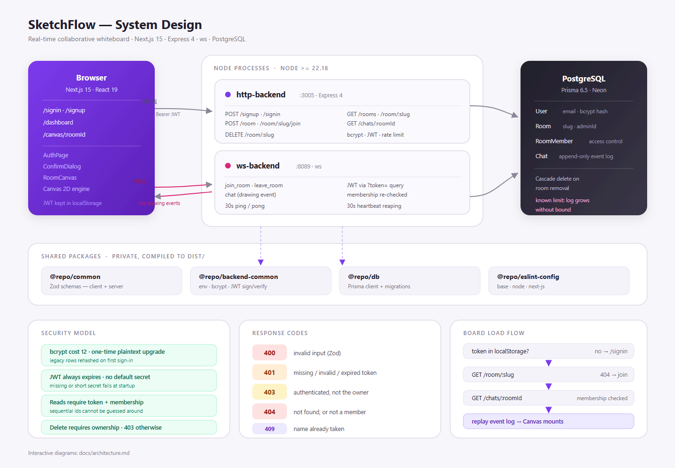
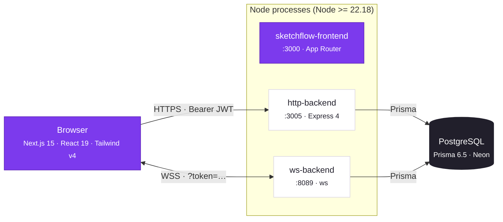
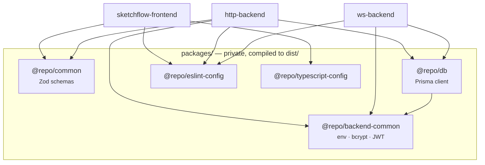
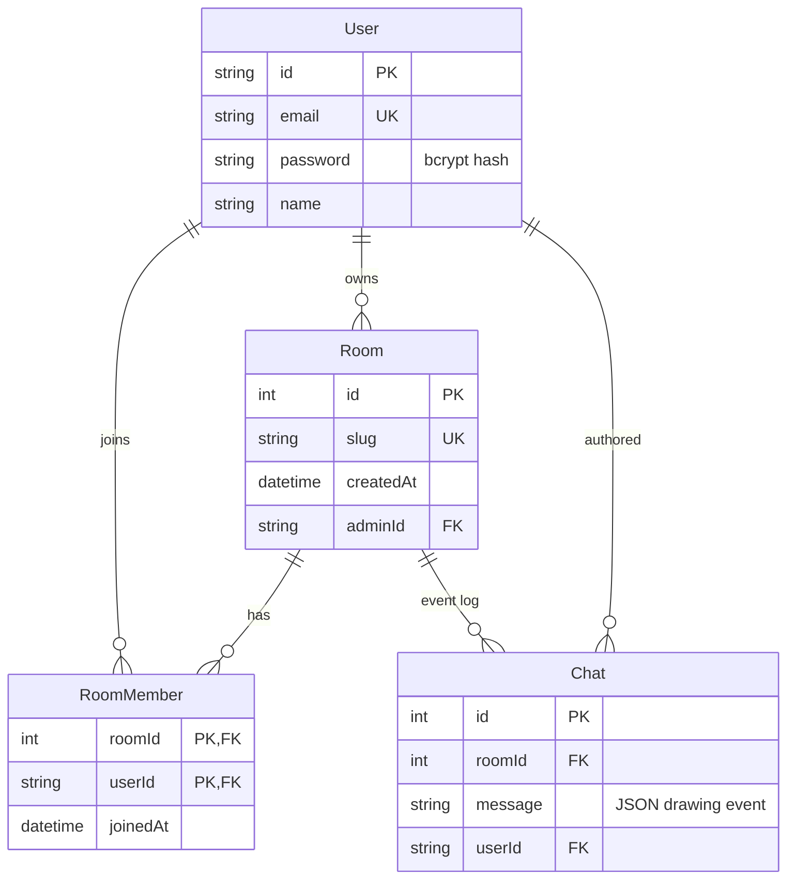
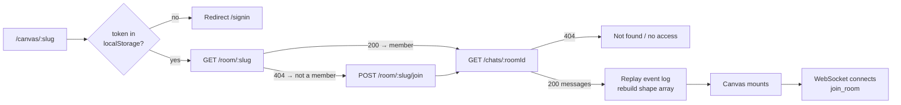
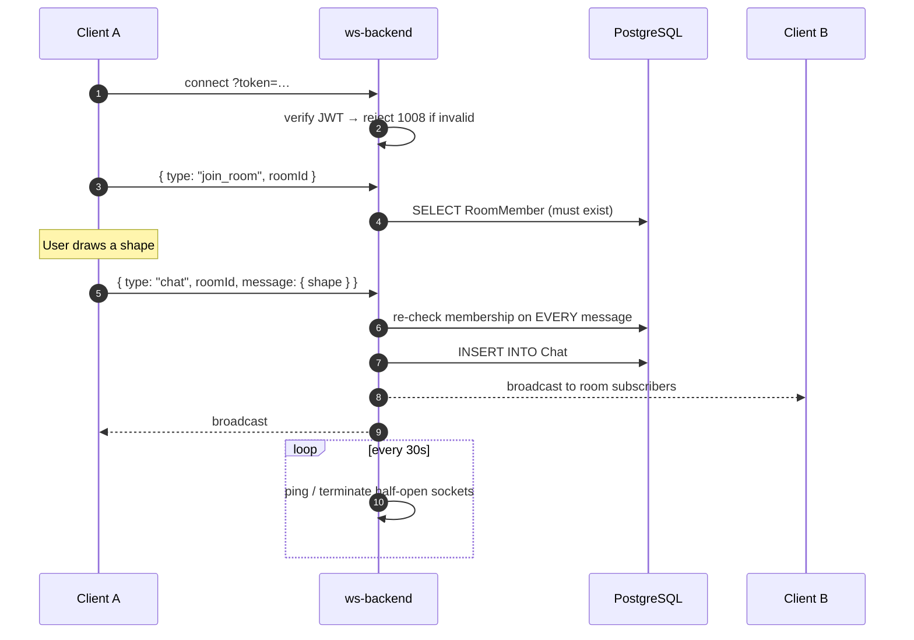
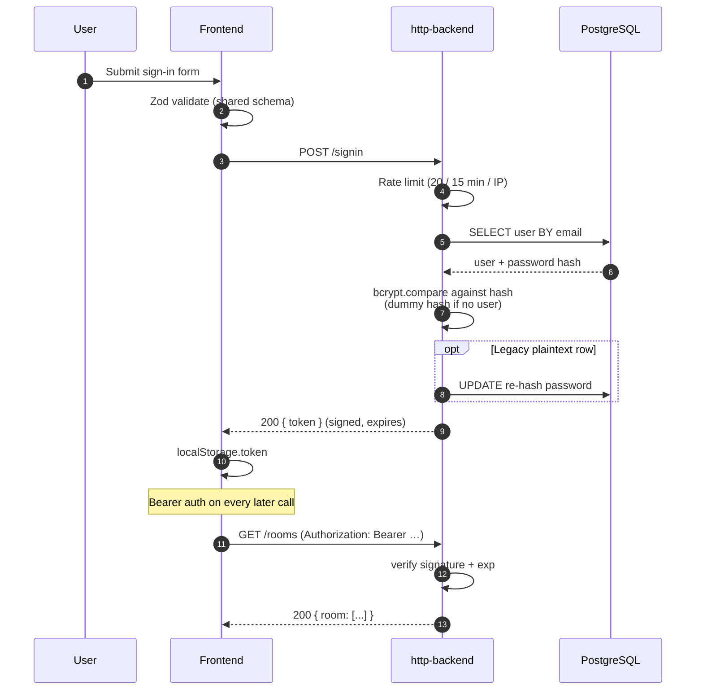
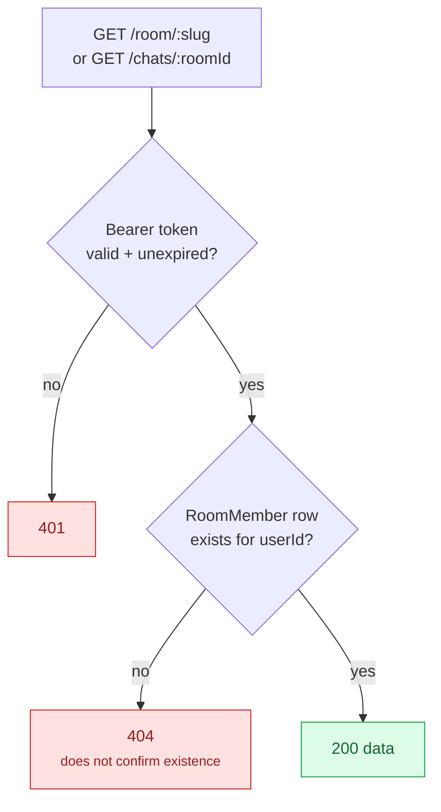

# SketchFlow

A real-time collaborative whiteboard. Draw together on a shared canvas, with every
shape persisted so a board is exactly where you left it.

Stack: **Next.js 15** (App Router, React 19, Tailwind v4) · **Express 4** REST API ·
**ws** realtime server · **PostgreSQL** via **Prisma** · **Turborepo** monorepo · **pnpm**.



Source: [`docs/architecture.svg`](docs/architecture.svg)

---

## Architecture

SketchFlow runs as **three independent processes** rather than one monolithic app.

- **`sketchflow-frontend`** (`:3000`) renders the UI and owns no state worth losing.
  The canvas is an imperative Canvas 2D engine driven from React through a small
  handle object, because redrawing hundreds of shapes through the React reconciler
  on every mouse move would not hold frame rate.
- **`http-backend`** (`:3005`) is the only process that talks to Postgres. Every
  authentication decision and every persisted write goes through it.
- **`ws-backend`** (`:8089`) handles realtime fan-out only. It never renders HTML.

The split exists because the two access patterns conflict. Realtime connections are
long-lived, stateful and cheap to hold open; API requests are short, cacheable and
want strict auth middleware. Keeping them in one process would force one deployment
unit to scale for both, and a slow socket broadcast would stall HTTP requests.

The two servers share `@repo/backend-common`, so JWT signing and verification use
literally the same code path — a token minted on `:3005` validates on `:8089`
without any shared session store.

### Request flow at a glance

Opening a board is four round trips, and each one is a place authorization can fail:

1. `GET /room/:slug` — is the caller a member? A `404` here means not yet.
2. `POST /room/:slug/join` — only then, if the board was shared with them.
3. `GET /chats/:roomId` — replay the event log and rebuild the shape list.
4. WebSocket connect — subscribe to live drawing events.

### Shared packages

The shared packages exist to eliminate the class of bug where the browser validates
something the server does not. There is exactly **one** definition of every request
schema, in `@repo/common`, and both the forms and the API import it.

---

## Quick start

Requires **Node >= 22.18** and **pnpm >= 9**.

> The shared packages (`@repo/common`, `@repo/db`, `@repo/backend-common`) compile to
> `dist/` and are loaded directly by the servers through their `exports` maps, so
> older Node releases cannot boot the backends.

```bash
pnpm install        # also runs `prisma generate`
cp .env.example .env
pnpm db:deploy      # apply migrations
pnpm dev            # runs all three apps via turbo
```

| App              | URL                   |
| ---------------- | --------------------- |
| Web app          | http://localhost:3000 |
| HTTP API         | http://localhost:3005 |
| WebSocket server | ws://localhost:8089   |

Generate a signing secret:

```bash
node -e "console.log(require('crypto').randomBytes(48).toString('base64url'))"
```

---

## Environment

All variables live in a single `.env` at the repo root. The backends load it with
`dotenv`; the Prisma CLI commands load it through `dotenv-cli`. Real environment
variables always take precedence over the file.

| Variable                   | Required | Default                 | Notes                                     |
| -------------------------- | -------- | ----------------------- | ----------------------------------------- |
| `DATABASE_URL`             | yes      | —                       | Postgres connection string.               |
| `JWT_SECRET`               | yes      | —                       | **>= 32 chars.** Startup fails otherwise. |
| `JWT_EXPIRES_IN`           | no       | `7d`                    | Access token lifetime.                    |
| `BCRYPT_ROUNDS`            | no       | `12`                    | Password hashing cost.                    |
| `HTTP_BACKEND_PORT`        | no       | `3005`                  |                                           |
| `WS_BACKEND_PORT`          | no       | `8089`                  |                                           |
| `PUBLIC_API_ORIGIN`        | prod     | —                       | CORS allowlist. Required in production.   |
| `NEXT_PUBLIC_HTTP_BACKEND` | no       | `http://localhost:3005` | Web app -> API.                           |
| `NEXT_PUBLIC_WS_URL`       | no       | `ws://localhost:8089`   | Web app -> WebSocket.                     |

---

## Repository layout

```
apps/
  sketchflow-frontend   Next.js app: auth, dashboard, canvas
  http-backend          Express REST API
  ws-backend            WebSocket realtime server
packages/
  common                Zod schemas shared by client and server
  backend-common        env loading, bcrypt helpers, JWT sign/verify
  db                    Prisma client, schema, migrations
  eslint-config         shared lint configs (base / node / next-js / react-internal)
  typescript-config     shared tsconfigs
```

Every package is `private` and compiled to `dist/`. `turbo` builds dependencies
before dependents, and `dev` depends on `^build` so shared packages are always current.

### How the pieces connect



`http-backend` and `ws-backend` both import the same `@repo/backend-common` module,
so a token minted on `:3005` verifies identically on `:8089`.



---

## HTTP API

`http-backend` is the only process that touches the database. Every route except
signup and signin requires `Authorization: Bearer <token>`.

| Method   | Route              | Access        | Purpose                                  |
| -------- | ------------------ | ------------- | ---------------------------------------- |
| `POST`   | `/signup`          | public        | Create account, bcrypt-hash the password |
| `POST`   | `/signin`          | public        | Verify credentials, issue a JWT          |
| `POST`   | `/room`            | authenticated | Create a board; creator becomes a member |
| `GET`    | `/rooms`           | authenticated | Boards you are a member of               |
| `GET`    | `/room/:slug`      | member        | Board metadata and `isOwner`             |
| `POST`   | `/room/:slug/join` | authenticated | Join via a shared link (idempotent)      |
| `DELETE` | `/room/:slug`      | **owner**     | Delete board; chats and members cascade  |
| `GET`    | `/chats/:roomId`   | member        | Replay the drawing event log             |

Status codes: `400` invalid input, `401` missing/invalid/expired token, `403`
authenticated but not the owner, `404` not found or not a member, `409` name taken.

---

## Data model



- **User** — `email` (unique), bcrypt `password`, `name`.
- **Room** — a board. `slug` is unique and appears in the URL. `adminId` is the owner.
- **RoomMember** — join table backing board access. The creator is inserted as a
  member when the board is created; collaborators join through a shared link.
- **Chat** — an **append-only log of drawing events**, one row per add/erase/undo.
  Despite the name it is not a chat transcript.

> **Known limitation.** Because drawing state is an append-only event log, a board's
> history grows without bound and `GET /chats/:roomId` replays all of it on every
> page load, so load time degrades as a board accumulates activity. Replacing the log
> with a `Shape` table (upsert on add, delete on erase) is the intended fix; it is
> not done yet.

---

## Canvas

A single imperative Canvas 2D engine in `app/draw/index.ts`, driven from React
through the `DrawInstance` handle. Tools: pencil, line, rectangle, circle, diamond,
text, eraser. Plus undo, PNG export, theme toggle, and pan/zoom.

Pan with <kbd>Space</kbd>-drag, middle-drag, or <kbd>Shift</kbd>-drag. Zoom with
<kbd>Ctrl</kbd>-scroll or the toolbar buttons.

The toolbar wraps to a second row on narrow viewports rather than overflowing, and
the Share button copies the board URL with a clipboard fallback for non-secure
origins, confirming success or failure inline.

### Loading a board



The `404 → join` fallback is what makes the Share button work: a recipient who has
never opened the board gets `404` on lookup, and the client transparently joins via
the shared link instead of showing an error. A second collaborator is therefore
indistinguishable from the owner once they have opened the link once.

### Live drawing



The token travels in the query string because browsers cannot set headers on a
WebSocket handshake. That is also why tokens **must expire** — a URL ends up in
proxy logs and browser history in a way an `Authorization` header does not.

Drawing events ride the same `chat` frame type that the event log uses, so a stroke
is broadcast to peers and persisted in one step. There is no separate in-memory
state: the canvas is rebuilt by replaying the log, which is what makes a refresh
restore the board exactly.

Every 30 seconds the server pings each socket and drops the ones that missed two
rounds. Without that, half-open connections accumulate in the subscriber map and the
process leaks memory slowly.

---

## Security

### Signing in



Three details in that flow are deliberate and worth calling out.

The schema is validated **twice** — once in the browser for instant feedback, once on
the server because a browser check is a courtesy, not a control. Both use the same
Zod object, so they cannot drift.

Password comparison runs against a **dummy bcrypt hash when the account does not
exist**. Without it, a missing account returns measurably faster than a wrong
password, which turns `/signin` into an account-enumeration oracle.

The `opt` branch is a one-time migration. Rows written before hashing existed are
re-hashed on the next successful sign-in and never compared in plaintext again,
which means upgrading the app does not require resetting anyone's password.

### Authorization

Every board read follows the same two-gate decision:



A non-member gets `404`, not `403`. Returning `403` would confirm the board exists,
which leaks the entire `Room` table to anyone who can guess a slug — and room ids are
sequential integers, so `GET /chats/:roomId` would otherwise be enumerable by simply
counting.

The same check runs on the **WebSocket side**, and it runs on every message rather
than only at `join_room`. Revoking someone's membership therefore takes effect
immediately instead of lingering until their next reconnect.

### Summary

- Passwords are hashed with bcrypt (cost 12 by default). The sign-in path performs a
  transparent one-time upgrade for any row still holding a legacy plaintext password.
- Password verification always runs against a dummy hash when the account does not
  exist, so response timing does not reveal whether an email is registered.
- Access tokens carry an expiry. There is no default `JWT_SECRET`: a missing or weak
  secret is a startup error, not a silent fallback.
- Board reads require a valid token **and** membership. Board ids are sequential, so
  membership is enforced explicitly rather than relying on unguessable URLs.
- The WebSocket server re-checks room membership on **every** inbound message, so a
  revoked membership takes effect immediately instead of on the next reconnect.
- Deleting a board requires ownership.
- `/signin` and `/signup` are rate limited per IP (20 requests / 15 minutes) and
  malformed WebSocket frames are dropped without killing the socket.
- Errors return a generic message. Stack traces are logged server-side, never sent.

### Before deploying

- [ ] Rotate the database password that previously sat in plaintext on disk.
- [ ] Set `PUBLIC_API_ORIGIN` so CORS is not left on localhost defaults.
- [ ] Set a strong, unique `JWT_SECRET`.

---

## Scripts

| Command             | Description                           |
| ------------------- | ------------------------------------- |
| `pnpm dev`          | Run every app in watch mode           |
| `pnpm build`        | Build all packages and apps           |
| `pnpm lint`         | ESLint across every workspace         |
| `pnpm check-types`  | `tsc --noEmit` across every workspace |
| `pnpm verify`       | lint + check-types + build            |
| `pnpm format`       | Prettier write                        |
| `pnpm format:check` | Prettier check (used in CI)           |
| `pnpm db:generate`  | Regenerate the Prisma client          |
| `pnpm db:migrate`   | Create and apply a migration (dev)    |
| `pnpm db:deploy`    | Apply pending migrations (production) |
| `pnpm db:studio`    | Prisma Studio                         |

---

## Contributing

```bash
pnpm install
pnpm verify        # must be clean
pnpm dev
```

CI runs `lint`, `check-types`, `build`, a Prettier check, and a dependency audit on
every push and pull request. There is no test suite yet; changes to auth, board
authorization, or the drawing engine should be verified manually against a running
stack before merging.
