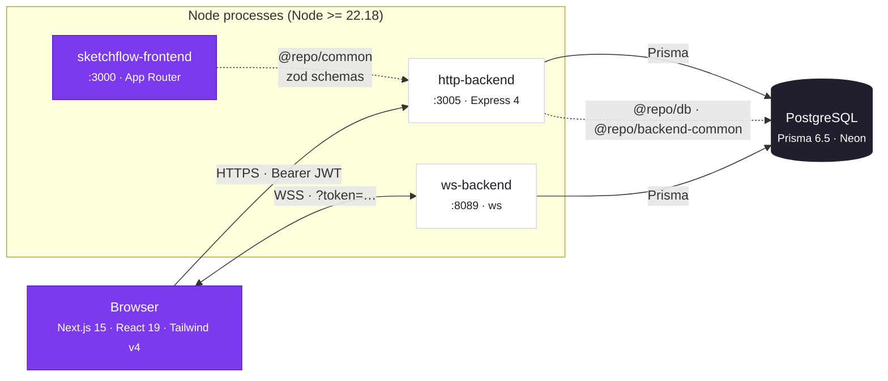
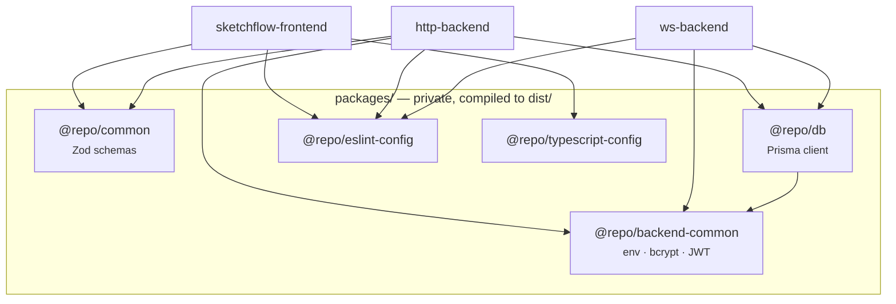
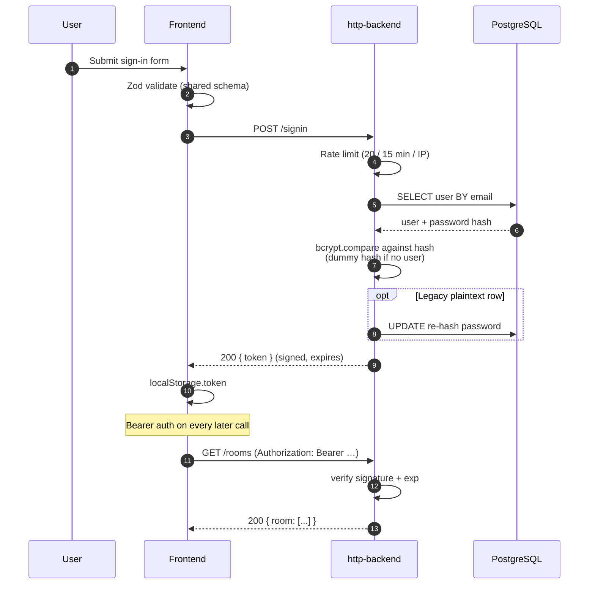
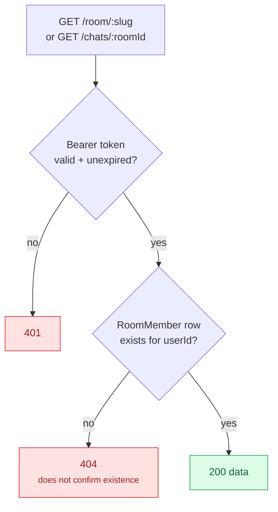
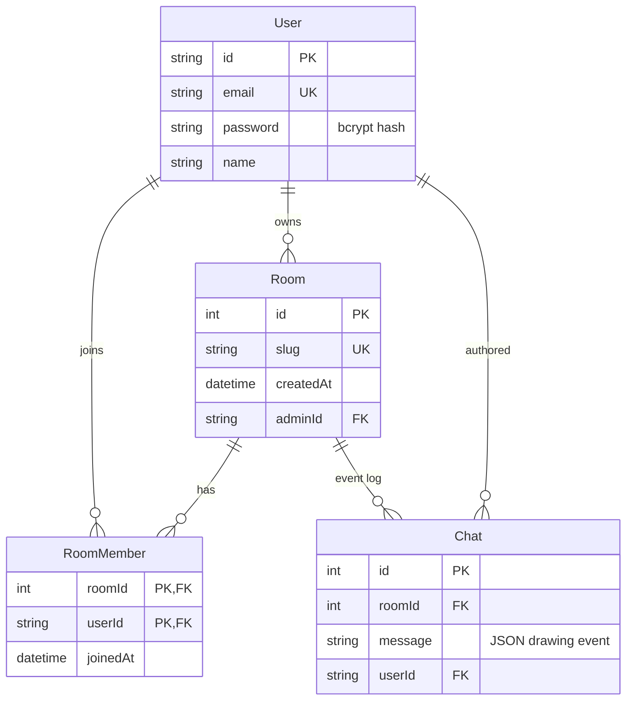
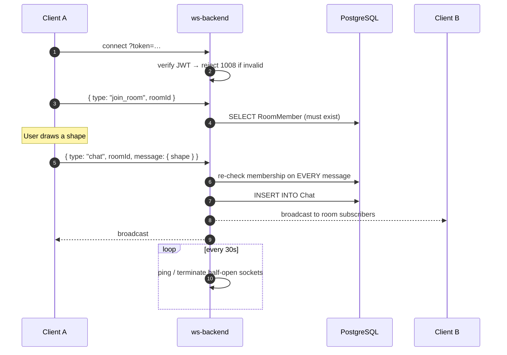
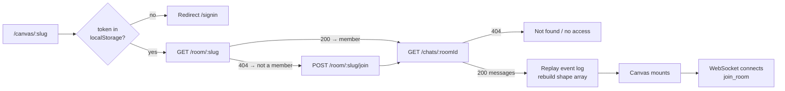

# SketchFlow — System Design

## 1. Container view

## 2. Shared packages

## 3. Authentication sequence

## 4. Board authorization

## 5. Data model

## 6. Realtime event flow

## 7. Request lifecycle on a board load

